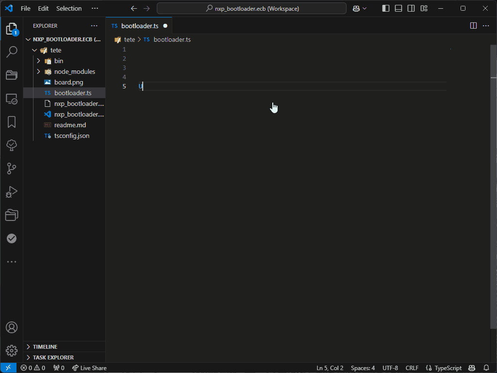
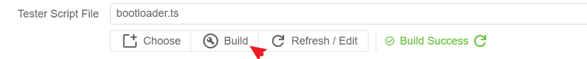
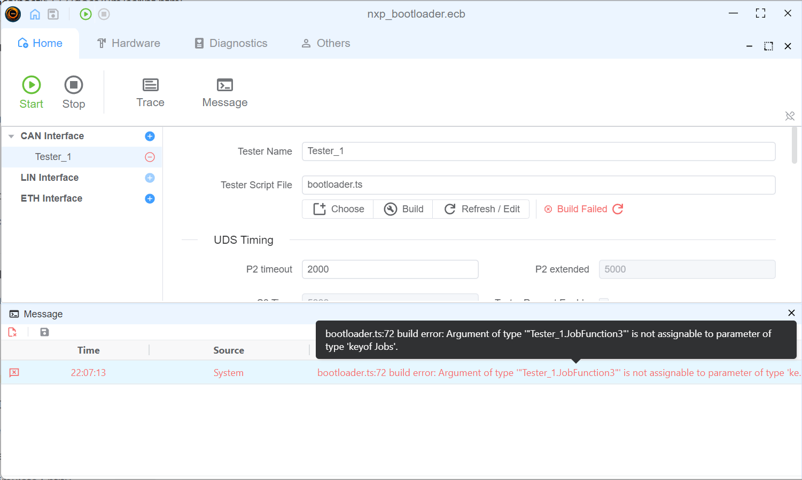
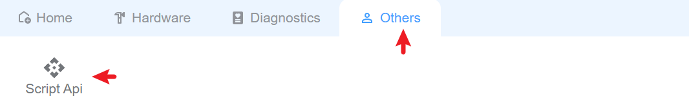

# 脚本

基于node.js环境中TypeScript/JavaScript的脚本。我们使用`ts`进行语法检查，使用esbuild构建脚本，构建脚本位于`.ScriptBuild`文件夹中。

## 编辑器

推荐使用Vscode编辑脚本，您可以安装`TypeScript`扩展以获得语法检查和智能提示功能。


> [!TIP]
> 我们还计划提供一个vscode扩展，让您可以直接在vscode中构建脚本。

## 构建脚本


如果脚本中有任何错误，您可以在`Message`窗口中获取构建错误信息。


## 脚本API

您可以打开`API`窗口获取API信息。


或查看此在线文档[API](https://app.whyengineer.com/scriptApi/index.html)

## 脚本使用

### Node.js功能

#### 初始化

Init函数是脚本的入口点，在脚本加载时会被调用。

```typescript
Util.Init(() => {
  console.log('Init')
})
```

#### 定时器

定时器是node.js的内置功能，您可以使用它来执行一些周期性工作。有关定时器的更多详细信息，请参阅[Timer](https://nodejs.org/api/timers.html)

```typescript
// periodical output can message
let timer = setInterval(() => {
  outputCan(canMsg)
}, 1000)

// stop the timer
clearInterval(timer)

//refresh the timer
timer.refresh()
```

#### 按键事件

监听按键事件，您可以在按键被按下时执行一些操作。

```typescript
// listen to the key event
Util.OnKey('s', () => {
  outputCan(canMsg)
})
```

#### CAN消息监听

监听CAN消息，您可以在接收到CAN消息时执行一些操作。

```typescript
// listen to the can message
Util.OnCan(0x1, (msg) => {
  console.log(msg)
})
// listen all can message
Util.OnCan(true, (msg) => {
  console.log(msg)
})
```

#### 事件监听

监听UDS消息。
`${tester name}.${service item name}.recv`用于监听接收到的UDS消息。
`${tester name}.${service item name}.send`用于监听发送的UDS消息。

```typescript
// listen to the uds message
Util.On('Can.DiagRequest.recv', (msg) => {
  //receive diag response
})
Util.On('Can.DiagRequest.send', (msg) => {
  //receive diag request
})
```

#### runUdsSeq 进度

`runUdsSeq` 运行一个已配置的序列（`TesterName.SequenceName`）。不带回调的调用保持不变。传入 `onProgress` 可获知当前正在运行的是哪个已启用项以及整体百分比。该回调在项开始时（`phase: 'start'`）运行，并在项完成时（`phase: 'finish'`）再次运行。

`index` 是已启用项中从 0 开始的位置，`total` 是将要运行的这些项的总数，`pct` 从第一个开始时的 `0` 变化到最后一次完成后的 `100`。禁用的项会被跳过。如果某项失败并导致序列停止，该项只有 `start` 事件，并且 promise 会被拒绝。抛出异常或返回被拒绝 promise 的回调会被记录，且不会停止序列。不会等待回调完成。

```typescript
import { runUdsSeq } from 'ECB'

await runUdsSeq('Tester.Seq0', {
  onProgress(info) {
    console.log(`${info.phase} ${info.index + 1}/${info.total} ${info.name} ${info.pct}%`)
  }
})

// 设备名称与进度一起
await runUdsSeq('Tester.Seq0', 'Device1', {
  onProgress(info) {
    console.log(info.serviceId, info.pct)
  }
})
```

## 示例

:::details 在脚本初始化时发送10条CAN消息，然后在30秒延时后发送另一条消息{open}

```typescript
async function sendCanMessage(msgId: number, targetId: number, dataPattern: string) {
    console.log(`sendCanMessage called with msgId: ${msgId}, targetId: ${targetId}`);

    const dataBytes = Buffer.from(dataPattern.repeat(8), 'hex');
    console.log("Total Length:", dataBytes.length);

    const fdMsg: CanMessage = {
        id: targetId,
        dir: 'OUT',
        data: dataBytes,
        msgType: {
            idType: CAN_ID_TYPE.STANDARD,
            brs: true,
            canfd: true,
            remote: false,
        }
    };

    try {
        await output(fdMsg);
    } catch (error) {
        console.error(`CAN FD 发送失败 (ID: ${msgId}):`, error);
    }

}

Util.Init(async () => {
    console.log("Init");
    // 循环 10 次，定义不同的消息 ID 和数据内容
    for (let i = 0; i < 10; i++) {
        const msgId = 0x510 + i;
        const targetId = 0x520 + i;
        const dataPattern = i % 2 === 0 ? '1234567890ABCDEF' : 'FFAABBCCDDEE5599';
        await sendCanMessage(msgId, targetId, dataPattern);
    }

    setTimeout(() => {
        console.log("Timeout triggered, preparing to send CAN message...");
        const msgId = 0x510 + 10;
        const targetId = 0x520 + 10;
        const dataPattern = 'DEADBEEFCAFEBABE';
    
        sendCanMessage(msgId, targetId, dataPattern);
    }, 30000); // 延时 30 秒
})
```

:::
